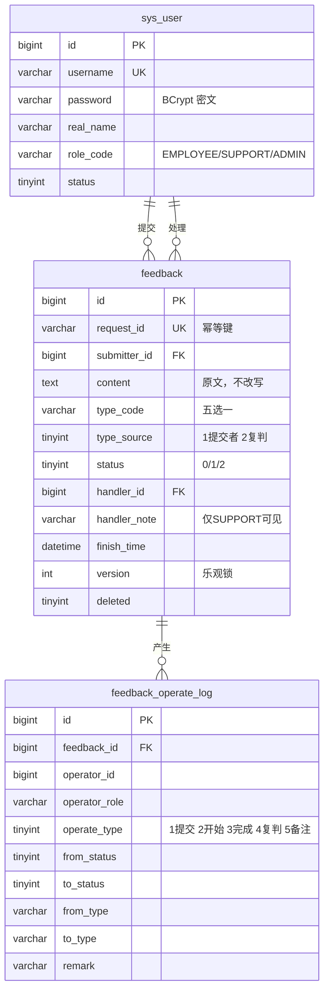
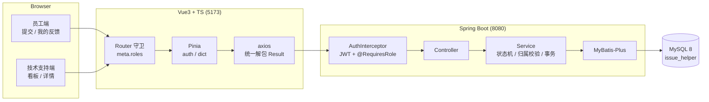

# 企业内部问题登记小助手

员工把聊天里那句"系统又转圈了"粘进来提交，技术支持按类型和状态把它处理完，双方都能看到进展。

一个可在本地运行的小系统：**Vue3 + TypeScript 前端，Spring Boot + MySQL 后端**。核心链路是「提交（原文 + 编号 + 类型）→ 落库 → 支持人员筛选处理 → 提交者回看进度」。

- 📄 详细设计：[开发文档.md](开发文档.md)（表设计、状态机、接口契约、取舍与演进）
- 📋 原始题目：[要求文档.md](要求文档.md)

---
## 视频演示
[点击查看演示视频](./11月12日.mp4)


## 1. 技术栈

| 层 | 选型 |
| --- | --- |
| 前端 | Vue 3.5 + TypeScript + Vite 8 + Element Plus + Pinia + Vue Router + axios |
| 后端 | Java 17 + Spring Boot 4.1.2 + MyBatis-Plus 3.5.15 |
| 数据库 | MySQL 8.0（InnoDB / utf8mb4） |
| 认证 | JWT（java-jwt 4.4）+ BCrypt 密码哈希 |
| 工程约定 | 统一返回体 `Result<T>`、全局异常处理、`@RequiresRole` 拦截器、乐观锁 `@Version` |


## 2. 环境要求

| 组件 | 版本 | 说明 |
| --- | --- | --- |
| JDK | 17+ | Spring Boot 4 要求 |
| Maven | 3.9.x | **不要用 3.10**，与部分 IDEA 版本的内置 Maven 集成不兼容（见 3.4） |
| Node.js | 22.18+ / 24+ | Vite 8 要求；`package.json` 里写的是 24.12+，低一点只会告警 |
| MySQL | 8.0+ | 本项目在 8.0.40 上验证 |
| 浏览器 | Chrome / Edge 最新版 | — |

## 3. 启动步骤

### 3.1 建库建表（只做一次）

```bash
mysql -uroot -p < backend/demo/demo/src/main/resources/db/schema.sql
```

脚本会创建 `issue_helper` 库和三张表。**不要** 打开 `spring.sql.init.mode=always`，否则每次重启都会 `DROP TABLE`，演示中途数据会丢。

### 3.2 配数据库连接

`backend/demo/demo/src/main/resources/application.yaml` 默认读环境变量，也可以直接改：

```yaml
spring:
  datasource:
    url: jdbc:mysql://localhost:3306/issue_helper?...
    username: ${DB_USERNAME:root}
    password: ${DB_PASSWORD:你的数据库密码}   # 改成你自己的，或用环境变量 DB_PASSWORD 注入
```

### 3.3 启动后端（端口 8080）

```bash
cd backend/demo/demo
mvn spring-boot:run
```

首次启动会自动灌入 **9 个演示账号 + 8 条样例反馈**（仅当 `sys_user` 为空时执行，重复启动不会重复插入）。日志出现这两行即成功：

```
Started IssueHelperApplication in 2.011 seconds
演示数据灌入完成：9 个账号，8 条样例反馈
```

### 3.4 启动前端（端口 5173）

```bash
cd frontend/demo
npm install
npm run dev
```

打开 <http://localhost:5173>。Vite 已配 `/api` → `http://localhost:8080` 代理，后端保持运行即可。


### 3.5 目录说明

```
backend/demo/demo/   # 后端工程（脚手架解压残留的嵌套层级，pom.xml 在这一层）
frontend/demo/       # 前端工程
```

## 4. 演示账号

密码统一 `123456`。

| 账号 | 姓名 | 角色 | 用途 |
| --- | --- | --- | --- |
| `xli` | 小李 | 员工 | 提交 R001 / R004 |
| `xzhou` | 小周 | 员工 | 提交 R002 |
| `xchen` | 小陈 | 员工 | 提交 R003 |
| `xwang` | 小王 | 员工 | 提交 R005 |
| `xzhang` / `xzhao` / `xsun` | 小张 / 小赵 / 小孙 | 员工 | 提交 R006 / R007 / R008 |
| `support01` | 张工 | 技术支持 | 看板、改状态、复判类型、写内部备注 |
| `support02` | 李工 | 技术支持 | 同上 |

## 5. 角色与操作边界

| 能力 | 员工（提交者） | 技术支持（处理者） | 管理员 |
| --- | --- | --- | --- |
| 提交反馈 | ✅ | ✅ | ✅ |
| 查看反馈列表 | 仅本人 | 全部 | 全部 |
| 查看原文 | 仅本人 | ✅ | ✅ |
| 查看内部备注 `handler_note` | ❌ 响应里没有该字段 | ✅ | ✅ |
| 修改状态 | ❌ 403 | ✅ | ✅ |
| 复判类型 | ❌ | ✅（已完成不可改） | ✅ |
| 用户管理 / 导出 | ❌ | ❌ | 预留未实现 |

三条边界由**后端强制**，不是前端藏按钮：

1. **行级**：员工只能查到 `submitter_id = 自己` 的记录。
2. **字段级**：`handler_note` 与日志里的内部说明，只对 `SUPPORT/ADMIN` 组装进响应；员工侧字段直接不存在。
3. **动作级**：`PATCH /status|type|note` 由 `@RequiresRole("SUPPORT")` 拦截，绕过前端直接 `curl` 也是 403。

## 6. 页面与操作

| 路由 | 谁在用 | 能做什么 |
| --- | --- | --- |
| `/login` | 全部 | 账号密码登录，可一键填入演示账号 |
| `/submit` | 全部 | 自动生成提交编号、五选一类型、**智能识别（仅建议，可改）**、粘贴原文、提交 |
| `/my` | 员工 | 只看自己的反馈，按状态筛选，点行打开详情看时间线 |
| `/board` | 技术支持 | 状态/类型/关键字筛选，行内「开始处理 / 完成」，详情里复判类型、写内部备注 |

演示建议顺序：员工提交 R001（选"系统故障"）→ 同一编号再提交一次看 40901 → 提交纯空格看 400 → 切 `support01` 进看板筛选并推进状态 → 员工回看时间线 → 最后演示内部备注在员工侧不可见。

## 7. API 说明

### 7.1 统一返回体

HTTP 状态码固定 200，业务结果看 `code`：

```json
{ "code": 200, "message": "success", "data": { }, "timestamp": 1731571200000 }
```

| code | 含义 |
| --- | --- |
| 200 | 成功 |
| 400 | 参数校验失败（空白内容、类型非法、编号格式错、超长） |
| 401 | 未登录 / token 失效 |
| 403 | 无权访问或无权操作 |
| 404 | 记录不存在 |
| 40901 | 提交编号已存在（幂等冲突） |
| 40902 | 当前状态不允许该操作（状态机） |
| 40903 | 记录已被他人修改（乐观锁版本冲突） |
| 40904 | 已完成，类型不可再修改 |
| 500 | 系统异常 |

### 7.2 接口清单

| 方法 | 路径 | 权限 | 说明 |
| --- | --- | --- | --- |
| POST | `/api/auth/login` | 公开 | 登录换 token |
| GET | `/api/auth/me` | 登录 | 当前用户信息 |
| GET | `/api/meta/dict` | 登录 | 类型/状态字典 |
| POST | `/api/meta/type-suggest` | 登录 | 类型建议（不落库） |
| POST | `/api/feedback` | 登录 | 提交反馈 |
| GET | `/api/feedback/my` | 登录 | 我的反馈（分页 + 状态筛选） |
| GET | `/api/feedback` | SUPPORT | 全部反馈看板（状态/类型/关键字筛选） |
| GET | `/api/feedback/{id}` | 本人或 SUPPORT | 详情 + 操作时间线 |
| GET | `/api/feedback/by-request/{requestId}` | 本人或 SUPPORT | 按编号回查 |
| PATCH | `/api/feedback/{id}/status` | SUPPORT | 更新状态（带 version） |
| PATCH | `/api/feedback/{id}/type` | SUPPORT | 类型复判 |
| PATCH | `/api/feedback/{id}/note` | SUPPORT | 写内部备注 |


## 8. 主要数据结构

ER 图：



三个关键约束：

| 约束 | 实现 |
| --- | --- |
| 相同 `request_id` 不产生两条记录 | `uk_request_id` 唯一索引兜底 + 捕获 `DuplicateKeyException` 转 40901（不用"先查后插"，那有并发窗口） |
| 只有空格的反馈不保存 | `TextGuard.normalize()` 处理半角/全角/零宽空格后判空；`content` 存原文，规范化结果只用于判断、不入库 |
| 非法状态跳转 | `FeedbackStatus.canGoTo()` 迁移表：待处理→处理中→已完成，允许待处理直接完成，已完成是终态 |

## 9. 业务假设

题目里的歧义点先写成假设，再按假设实现（完整 12 条见 [开发文档.md](开发文档.md) §1.3）：

1. `request_id` 由**提交端生成**，全局唯一，格式 `REQ-yyyyMMdd-6位随机`。
2. 同一编号重复提交返回 **40901**，不新增、不覆盖原文——编号是一次提交的身份。
3. 编号撞号但来自别人时，**不透露**原记录任何内容。
4. 类型由**提交者必选**（五选一），系统只给"建议"，落库的是用户确认过的值；说不清就选"待确认"——这是"不得捏造缺失信息"的落地方式。
5. 技术支持可在"待处理/处理中"复判类型并留痕；"已完成"后锁定。
6. 员工不能改原文、不能撤回；原文是证据，只增不改。
7. 状态只有三态；"待处理直接完成"允许（咨询类答复即结案），不允许回退。
8. 认证用 JWT + 演示账号，不接企业 SSO（题目明确不要求）。


## 10. 已完成 / 未完成

**已完成**

- 建表脚本 + 启动自动灌种子数据（9 账号 / 8 样例反馈）
- JWT 登录、拦截器、`@RequiresRole` 角色鉴权
- 提交反馈：原文保存、类型必选、唯一索引幂等、空白/长度/编号格式校验
- 员工端：我的反馈列表、详情、操作时间线
- 支持端：看板筛选、状态流转、类型复判、内部备注
- 字段级边界：内部备注与内部说明按角色裁剪
- 规则类型建议器（无 Key 可用，建议不落库）
- 日志：控制台输出，带 traceId 的访问日志 + 业务日志（不再落文件）
- 前端 4 个页面 + 路由守卫 + 统一响应解包
- 12 组用例（TC-01~TC-12 + TC-06b + 种子检查）、58 项断言的接口验收脚本，可重复执行

**未完成（有意的范围控制，非遗漏）**

- 管理员后台、用户/角色配置
- 附件上传、站内通知/邮件推送
- 超时自动关闭、SLA 统计
- 全文检索（当前 `LIKE` 对 11 万行量级够用）
- 大模型分类落地（只留规则实现与替换点）
- 前端自动化测试（目前前端靠手工过一遍）
- 导出、多租户

## 11. 系统结构




## 12. 已知限制

| 项 | 现状 | 影响 |
| --- | --- | --- |
| 认证 | 演示账号 + 7 天 JWT，无 refresh / 吊销 | 角色变更后旧 token 在有效期内仍可用 |
| 审计 | 操作日志应用层只增，DBA 仍可改 | 只能防误操作，不能防内部篡改 |
| 敏感信息 | 原文不做脱敏 | 员工可能把密码贴进来，上线前必须补 |
| 通知 | 无 | 员工不知道被回复，会重复提问 |
| 并发规模 | 单实例，无缓存 | 100 员工量级足够，扩容需先去掉进程内状态 |

---

**仓库结构**

```
.
├── README.md                  # 本文件
├── 开发文档.md                 # 详细设计（表/接口/状态机/取舍/演进）
├── 要求文档.md                 # 原始题目
├── tests/
│   ├── acceptance.ps1         # 可重复执行的接口验收
│   └── result.txt             # 最近一次结果
├── backend/demo/demo/         # Spring Boot 工程
│   └── src/main/resources/db/schema.sql
└── frontend/demo/             # Vue3 + TS 工程
```


[def]: ./11月12日.mp4